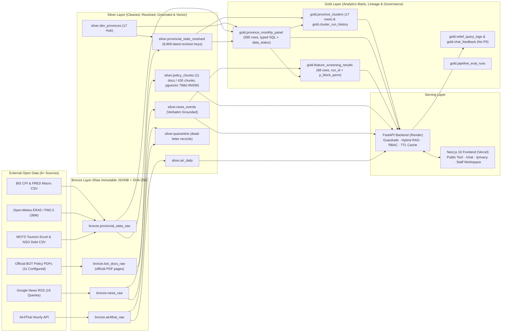

# NorthRisk Analytics (`วางแผนแก้หนี้และเศรษฐกิจภาคเหนือ`)

**Full title:** NorthRisk Analytics: A Debt-Relief Planning and Regional Economic Risk Analytics Platform for Thailand's 17 Northern Provinces  
**ชื่อเต็ม:** NorthRisk Analytics: ระบบวางแผนแก้หนี้และวิเคราะห์ความเสี่ยงเศรษฐกิจ 17 จังหวัดภาคเหนือ

An end-to-end **Medallion ELT Data Warehouse, Statistical Risk Analytics, and Grounded RAG Decision-Support Platform** for Thailand's 17 Northern Provinces.

The platform serves **two distinct user groups** from one shared, verifiable open-data foundation:
- **Public Portal (Citizens & SMEs):** Gross-income DSR & repayment simulator, lender negotiation dossier, 17-province seasonal risk calendar, official debt-relief program routing (with closed-program guards), and a citation-grounded Thai/English voice-enabled assistant.
- **Staff Workspace (Dual-Role RBAC):**
  - `policy_analyst`: Provincial vulnerability monitor, experimental Monte Carlo / Re-clustering Lab (`persist=false`), and printable 1-page A4 policy briefs.
  - `data_steward`: Medallion data-health dashboard, `silver.quarantine` dead-letter audit, layered evaluation logs, live ELT refresh triggers, and persisted cluster approval (`persist=true`).

---

## System Architecture (Python-Orchestrated Medallion ELT)



Scheduled automatically via [`.github/workflows/daily_elt.yml`](.github/workflows/daily_elt.yml):
- **`daily` (06:00 ICT daily):** Air4Thai live sensors, Google News RSS + Gemini verbatim extraction, SHA-256 incremental PDF sync, and Layer 2 Data Quality verification.
- **`full` (1st of each month, 07:00 ICT):** Full rebuild including MOTS, NSO, Open-Meteo 36M, BIS/FRED macro controls, Deep EDA, Feature Screening, Composite Shock Index, and 17-province Clustering.

---

## Single Source of Truth & Statistical Methodology

Analytics scripts, Gold tables, report figures, and the Web Clustering Lab use the feature contract defined in [`backend/config/feature_specs.yaml`](backend/config/feature_specs.yaml) (`v2.3.0`).

The current contract also contains data freshness/coverage gates, descriptive scoring thresholds, shock-index and clustering weights, and EDA resampling settings. These settings make a run reproducible; they do **not** make a rule-based score a calibrated probability or convert exploratory analysis into causal evidence. The pipeline checks upstream status and data coverage before Gold computation, then publishes the panel, feature-screening output, clusters, lineage, and run history in one database transaction.

Historical fit statistics below describe the previously recorded run only; they are not guarantees for future data or validation of the current configuration.

### What EDA does and does not establish

The monthly EDA screens exploratory associations between provincial economic/hazard inputs and tourism indicators (`occupancy_deseason`, `revenue_deseason_pct`, and `occupancy_yoy_diff`). Structural screening checks redundancy among province-level clustering features. Provincial household/SME debt survey measures are contextual aggregates; they are not individual borrower outcomes. This EDA does not establish causal effects, predict personal default, or measure whether a debt-relief program worked. Its practical role is to document data quality, seasonality, candidate signals, and limitations for the staff-facing regional context. The public debt calculator and debt-preparation flow use the individual's own entered scenario and deterministic calculations, separately from province averages. Alert and tier cutoffs are project-defined heuristics, not empirically calibrated default or eligibility thresholds.

1. **Canonical Core 6 Clustering Features (`N = 17`, `N/p = 2.83`, `max VIF = 4.07 < 5.0`):**
   - `avg_occupancy_rate` (`VIF 1.99`), `occupancy_volatility` (`VIF 4.07`), `log_foreign_visitor_share` (`log1p` reduces skew `+1.59 → +0.49`, `VIF 1.91`), `annual_pm25_days_over_37_5` (`VIF 1.59`), `max_monthly_rainfall_mm` (`VIF 1.64`), `debt_to_annual_income_all` (`VIF 1.82`).
   - Redundant proxies (`|r| >= 0.85`: `foreign_revenue_share`, `pm25_mean_3y`, `pm25_p90_3y`) and collinear candidates (`annual_heavy_rain_days` `VIF 33.76`, `debt_to_annual_income_sme` `VIF 5.10`) are pruned transparently and logged to `gold.feature_screening_results`.
2. **Media Concentration Bias Guardrail:** Across 244 verified events in `silver.news_events`, the top 3 provinces (`CR`, `CM`, `NN`) hold **48.8%** (`26.3x` max/min ratio). News volume is therefore excluded from quantitative models and kept as qualitative alerts / unchecked experimental toggle in the Staff Lab.
3. **Anti-Lookahead & Panel Dependence Controls:** Seasonal baselines, winsorization caps, rainfall regime cutoffs, and empirical Shock Index weights are fitted on the chronological training window. Dynamic screening uses within-province circular block permutation, BH-FDR across the tested feature-lag family, and Within-Province Fixed-Effects OLS with province-clustered covariance plus restricted Rademacher wild-cluster bootstrap. With 17 province clusters, results remain exploratory rather than confirmatory or causal.
4. **Historical Clustering Benchmark:** A previously recorded run selected `KMeans (k=4, StandardScaler)` across 24 model/scaler/`k` combinations (`Silhouette = 0.2712`, `DBI = 1.0253`, `CH = 8.91`, perturbation ARI `= 0.9838`, cross-scaler ARI `= 1.000`, KMeans/Ward ARI `= 0.8052`). These describe fit and stability in that run; stability does not establish that the groups are substantively valid or predict debt distress.

For full Architecture Decision Records (ADR), Data Dictionary, Objective Traceability Matrix, and Defense Q&A, see [`docs/ARCHITECTURE_DECISIONS.md`](docs/ARCHITECTURE_DECISIONS.md).

---

## Verification & Evaluation Snapshot (run `eval7d_bb3db28472`)

The checks and database/LLM metrics below are historical results recorded for specific prior code and data snapshots. They do not verify the current working tree or deployment; rerun them against the intended staging environment before presentation. Live evaluation rows reflect `eval7d_bb3db28472`.

| Verification Gate / Dimension | Result | Status |
| :--- | :--- | :---: |
| **Backend Unit, Guardrail, RBAC & Sync Tests (`pytest -v`)** | **62 / 62 passed** (`100%`) | PASS |
| **Frontend Static Verification (`lint`, `tsc`, `next build`)** | **0 lint errors (0 warnings)**, **0 TS errors**, **9/9 static routes built offline** | PASS |
| **Layer 2 Automated Data Quality (historical `feature_spec v2.0.0` run)** | **10 / 10 checks passed** (NSO 17/17, Quarantine 155 caught, 0 Bronze revision conflicts) | PASS |
| **Dim 1: PDF Retrieval (`n=15`, historical index: 10 docs / 418 chunks)** | Hit@5 **100.0%**, Hybrid RRF MRR **0.9556** (Vector: `0.9333`) | Historical result |
| **Dim 2: RAG proxy checks (6 in-scope + 10 traps)** | Citation Provenance **100.0%**, Trap Refusal **100.0%**, Answer Rate **83.33%**, Median **10.22s**; semantic answer accuracy was not evaluated | Historical proxy result |
| **Dim 3: News Extraction (`n=30` eval, 244 live events)** | Relevance **100%**, Province **100%**, Shock Type F1 **90.67%**, MAE **0.095**, Quote Match **100%** | PASS |
| **Dim 5: Security Guardrails (20 PII + 10 Injection)** | PII Recall **100.0%**, Prompt Injection Block **100.0%** | PASS |
| **Dim 6: Determinism & Clustering Stability** | LLM 3-Run **100.0%**, Perturbation ARI **0.9838**, Cross-Scaler ARI **1.000** | PASS |
| **Dim 7: Storage Efficiency & Governance** | Neon DB **21.37 / 512 MB** (`4.17%`), RAG Table **4.34 MB** (`0.85%`), Air4Thai 3d **15/17** (`88.2%`) | MONITORED |

> **PDF Quality Gate:** The active Neon `silver.policy_chunks` table now indexes **11 of 11 configured BOT PDFs (430 active chunks)**, including the four-page SMEs Secure+ framework (`25690074.pdf`, 12 chunks via human-reviewed Tesseract OCR). The historical `eval7d_bb3db28472` retrieval evaluation above was recorded on the earlier 10-document / 418-chunk snapshot. Image-only PDFs remain excluded until OCR is compared with the exact source and approved. For `smes_secure_plus_2569`, use BOT circular `25690074.pdf` and its attached framework; `25690073.pdf` is the corresponding circular for commercial financial institutions, not a standalone text PDF.

For a genuinely scanned source, a local OCR alternative that avoids Gemini vision calls is available. Install Tesseract and its Thai language data in WSL (`sudo apt install tesseract-ocr tesseract-ocr-tha`), then run `python scripts/prepare_tesseract_ocr_draft.py <doc_id>`. This creates or resumes a local OCR draft only; compare every page with the exact source PDF and use `scripts/approve_ocr_draft.py` only after human review. Local Tesseract availability is not assumed in Render or GitHub Actions.

### Schema migration and operational checks

After setting `backend/.env` to a **staging** PostgreSQL database, apply the idempotent schema before deploying code that uses the new columns:

```bash
cd backend
python scripts/apply_schema.py
python run_pipeline.py --mode full
```

Do not point the migration or full pipeline at production without a reviewed backup and an approved release window. `init_schemas.sql` adds tables and columns; it does not backfill historical `run_id` lineage or prove old rows were produced by the current feature contract. New runs populate those fields going forward.

Run the opt-in HTTP probe only against local/staging, not production by default:

```bash
cd backend
python tests/load_test.py --url https://<staging-api>/api/health --requests 100 --concurrency 10
```

---

## Repository Layout

```text
northern-risk-analytics/
├── .github/workflows/daily_elt.yml   # Automated daily & monthly Medallion ELT
├── render.yaml                       # Render deployment blueprint (FastAPI, Python 3.12)
├── shared/policy_catalog.json        # Canonical policy status registry (synced to BE & FE)
├── docs/ARCHITECTURE_DECISIONS.md    # ADR, Data Dictionary, Traceability Matrix & Defense Q&A
├── backend/
│   ├── config/                       # feature_specs.yaml v2.3.0, guardrails.yaml, sources.yaml
│   ├── data/eval/                    # Ground-truth benchmarks (rag_qa_eval, news_extraction_eval)
│   ├── reports/figures/              # 9 regenerated 300 DPI audit, EDA, backtest & eval charts
│   ├── src/
│   │   ├── extract/                  # Air4Thai, News RSS, MOTS/NSO, Open-Meteo, Macro, BOT PDFs
│   │   ├── transform/                # Silver cleaning, LLM shock extraction, Panel builder
│   │   ├── analytics/                # Deep EDA, Screening, Shock Index, Clustering, DSR, Lab
│   │   ├── rag/                      # Incremental pgvector indexer & Grounded Hybrid Assistant
│   │   ├── guardrails/               # PII redactor, prompt injection defense, RAG verifier, schemas
│   │   ├── evaluation/               # Layered evaluation & Layer 2 Data Quality assertions
│   │   ├── reporting/                # 1-page A4 executive policy brief generator
│   │   └── api/main.py               # FastAPI serving layer with RBAC, rate limits & TTL cache
│   ├── tests/                        # test_guardrails.py (59) + test_ocr_review.py (3) & run_eval.py (7D harness)
│   └── run_pipeline.py               # CLI entrypoint (--mode daily | full)
└── frontend/                         # Next.js 16 (App Router, Tailwind CSS, Recharts)
    ├── app/                          # /, /chat, /privacy, SEO routes (sitemap, robots, opengraph)
    ├── components/                   # Public relief simulator, 17P map, charts, Staff Workspace
    └── lib/                          # API client, DSR/dossier math, TH/EN i18n, map geometry
```

---

## Quick Start (Local Development)

### 1. Backend (FastAPI + Python 3.12)
```bash
cd backend
cp .env.example .env   # Fill DATABASE_URL, GEMINI_API_KEY, and STAFF_* credentials
pip install -r requirements.txt

# Run unit & guardrail test suite (62 tests)
python -m pytest -v

# Start local API server (http://127.0.0.1:8000)
uvicorn src.api.main:app --reload --port 8000
```

### 2. Run Medallion ELT & 7-Dimension Evaluation
```bash
cd backend
python run_pipeline.py --mode daily      # Incremental daily update
python run_pipeline.py --mode full       # Monthly full Gold rebuild + 300 DPI figures
python tests/run_eval.py                 # Live 7D evaluation & scorecard figure
```

### 3. Frontend (Next.js 16 + pnpm)
```bash
cd frontend
cp .env.example .env.local   # Set NEXT_PUBLIC_API_BASE_URL=http://127.0.0.1:8000
pnpm install
pnpm dev                     # http://localhost:3000
pnpm lint && npx tsc --noEmit --incremental false && pnpm build
```

---

## Known Limitations & Future Work
- **Usability Survey (SUS / CSAT):** No formal survey with external human participants has been collected yet; conducting a 10–20 user task-completion study is recommended prior to broader public rollout.
- **Purpose-boundary:** Staff regional screening and the public debt-preparation tool share data context, but serve different decisions. Provincial scores must not be presented as personal risk, lender eligibility, or evidence of program effectiveness.
- **Concurrent Load Testing:** API latency has been benchmarked sequentially; multi-user load testing (k6 / Locust) against Render remains future work.
- **Statistical Scope:** Monthly provincial panel regressions (`n = 578`, `R²_within = 0.122`) are exploratory screening tools, not causal econometric proofs.
- **Scanned PDF OCR:** Gemini and local Tesseract can prepare resumable drafts, but drafts require human comparison against the exact source PDF and explicit approval before indexing. The latest user-reported staging sync indexed the SMEs Secure+ document; verify the intended database before treating that as current deployment state.
